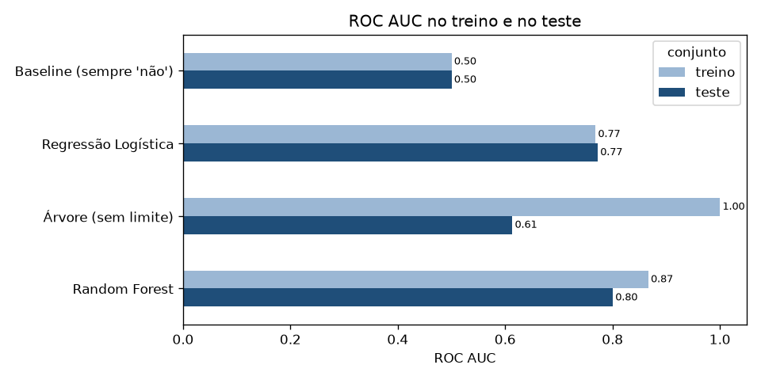
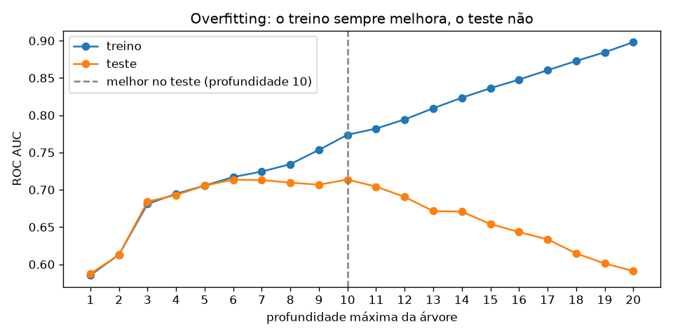
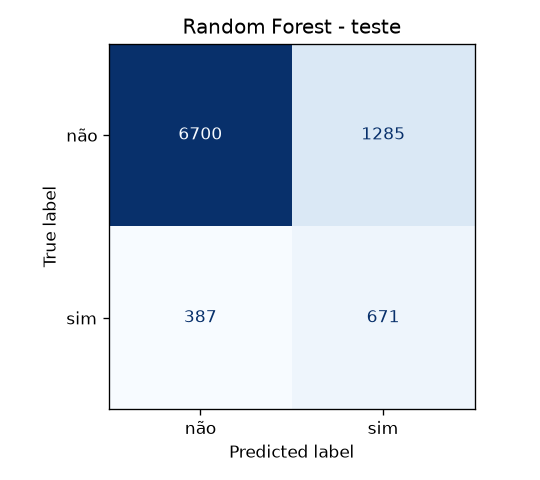
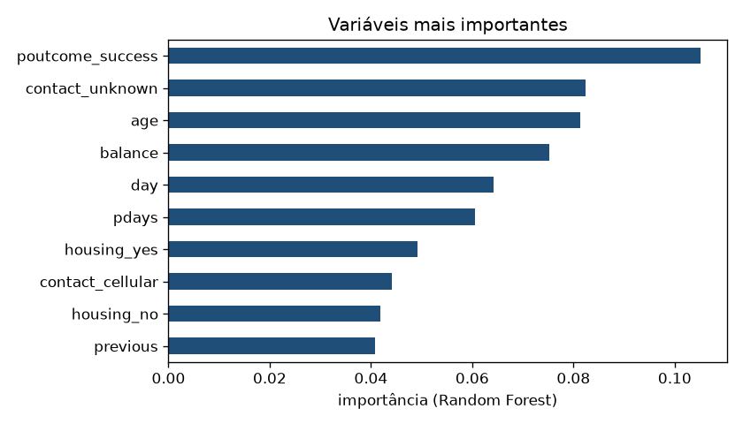

# Modelo preditivo: quem vai contratar o depósito a prazo?

<p align="left">
  
  
  
  
</p>

Classificação binária sobre uma base pública da UCI: prever, **antes de ligar**, quais clientes de um banco têm mais chance de contratar um depósito a prazo numa campanha de telemarketing. O modelo treinado é comparado com um **baseline** simples, com separação treino/teste, validação cruzada e uma análise de **overfitting**.

📓 **Notebook principal:** [`notebooks/modelo_preditivo.ipynb`](notebooks/modelo_preditivo.ipynb) (já salvo com as saídas, dá para ler direto no GitHub).

## Problema

Ligar para todos os clientes custa caro e só **11,7%** deles contratam. Um modelo que ordene os clientes pela chance de contratar permite ligar primeiro para quem tem mais potencial. A pergunta do projeto é: **um modelo simples consegue ser realmente melhor que não usar modelo nenhum?**

## Origem dos dados

| Item | Valor |
|---|---|
| Base | *Bank Marketing* — UCI Machine Learning Repository |
| Referência | Moro, S., Rita, P. & Cortez, P. (2014). https://doi.org/10.24432/C5K306 |
| Licença | CC BY 4.0 |
| Arquivo usado | `bank-full.csv` — 45.211 clientes, 16 variáveis + alvo |
| Contexto | Campanhas de um banco português, maio/2008 a novembro/2010 |
| Alvo | `y`: 1 = contratou o depósito (11,7%), 0 = não contratou (88,3%) |

O download é automático (`src/dados.py`) na primeira execução e fica em `data/` (fora do Git).

## Metodologia

1. **Vazamento de dados removido.** A coluna `duration` (duração da ligação) só existe depois da ligação e sozinha tem AUC de 0,81. Mantê-la daria métricas bonitas e um modelo inútil para decidir *quem ligar*, então ela é descartada.
2. **Separação treino/teste estratificada**: 80% / 20%, com a mesma proporção de "sim" nos dois conjuntos e semente fixa (`random_state=42`).
3. **Pré-processamento dentro de um `Pipeline`**: padronização das numéricas e one-hot das categóricas, ajustados só com o treino (sem espiar o teste).
4. **Modelos comparados**
   - **Baseline** — `DummyClassifier` que responde sempre "não";
   - **Regressão Logística** — linear e interpretável, `class_weight="balanced"`;
   - **Árvore sem limite** — incluída de propósito para mostrar overfitting;
   - **Random Forest** — 300 árvores, folhas com no mínimo 20 exemplos.
5. **Métricas**: acurácia, acurácia balanceada, precisão, recall, F1 e **ROC AUC** (principal, porque a base é desbalanceada e a AUC não depende do limiar de 0,5).
6. **Validação cruzada** estratificada de 5 folds no treino, para verificar se o resultado é estável.
7. **Overfitting**: comparação treino × teste de cada modelo e curva de AUC por profundidade da árvore.
8. **Exploração e análise de erros** (no notebook): distribuição e correlação das variáveis numéricas antes de modelar, e, depois, desempenho do modelo por grupo de clientes para ver em quem ele erra.

## Resultados

Conjunto de **teste** (9.043 clientes que o modelo nunca viu):

| Modelo | Acurácia | Acur. balanceada | Precisão | Recall | F1 | ROC AUC |
|---|---|---|---|---|---|---|
| Baseline (sempre "não") | **0,883** | 0,500 | 0,000 | 0,000 | 0,000 | 0,500 |
| Regressão Logística | 0,755 | 0,698 | 0,266 | 0,624 | 0,373 | 0,772 |
| Árvore (sem limite) | 0,831 | 0,613 | 0,298 | 0,329 | 0,313 | 0,613 |
| **Random Forest** | 0,815 | **0,737** | **0,343** | **0,634** | **0,445** | **0,800** |

Validação cruzada (5 folds, treino): Random Forest **0,791 ± 0,004** · Regressão Logística 0,764 ± 0,003 · Baseline 0,500.



### Overfitting



- A **árvore sem limite** tem AUC **1,00 no treino e 0,61 no teste**: decorou os clientes de treino.
- Na curva, treino e teste sobem juntos até a profundidade ~6; entre 6 e 10 o teste para de melhorar e, depois disso, **cai** enquanto o treino continua subindo.
- A **Random Forest** tem uma diferença treino-teste de ~0,07 (overfitting leve e controlado). A **Regressão Logística** praticamente não tem diferença.

### Exploração dos dados e onde o modelo erra

- **As variáveis numéricas têm correlação fraca com o alvo** (no máximo 0,10); o sinal está nas variáveis categóricas, principalmente o resultado da campanha anterior. Saldo, contatos e `previous` são muito assimétricos (poucos valores enormes), e `pdays` e `previous` têm correlação de 0,45 entre si.
- **O modelo erra de formas diferentes por grupo.** Entre clientes que já contrataram numa campanha anterior ele é muito confiável (recall 1,00, conversão real de 65%). Entre clientes nunca contatados, o grupo maior, ele encontra só metade dos que contratariam (recall 0,50). Para maiores de 60 anos (apenas 219 clientes no teste) ele aposta "sim" em quase todos, mas só 43% contratam: previsão pouco confiável nesse grupo.
- No geral, só cerca de 1 em cada 3 clientes indicados contrata (precisão de 0,34): o modelo ajuda a priorizar, mas gera muitas ligações perdidas.

### Na prática



Se o banco ligar só para os **20% de clientes com maior probabilidade** segundo a Random Forest, a conversão vai de **11,7% para 35,8% (3,1x)**, e esse grupo contém **61%** de todos os clientes que contratariam.



## Conclusões

1. **Acurácia engana em base desbalanceada**: o baseline tem a maior acurácia (88,3%) e não encontra nenhum cliente que contrataria (recall 0).
2. **O modelo supera o baseline com folga**: AUC 0,80 contra 0,50, resultado confirmado pela validação cruzada (desvio de apenas 0,004).
3. **Complexidade sem controle gera overfitting**: a árvore sem limite é perfeita no treino e a pior no teste entre os modelos reais.
4. **Métricas honestas valem mais que métricas altas**: sem `duration`, o modelo é mais fraco no papel, mas usa só o que se sabe antes da ligação.

## Limitações

- **Dados antigos e de outro país** (Portugal, 2008–2010, crise financeira). Não dá para assumir que o padrão vale para clientes brasileiros hoje.
- **Variáveis de campanha** (`month`, `day`, `contact`) descrevem *como* o banco ligou naquela época. O modelo pode estar aprendendo a estratégia da campanha antiga, e não só o perfil do cliente.
- **Limiar fixo de 0,5**: o corte ideal depende do custo de uma ligação e do lucro de uma venda, que não estão na base.
- **Hiperparâmetros escolhidos à mão**, de forma simples, para manter o projeto explicável. Um `GridSearchCV` poderia ganhar um pouco de AUC.
- **Probabilidades não calibradas**: com `class_weight="balanced"`, o modelo ordena bem os clientes, mas o valor de probabilidade não deve ser lido como chance real sem calibração.
- A **curva de profundidade** usa o conjunto de teste apenas para ilustrar o conceito; a escolha de hiperparâmetros deveria ser feita com validação cruzada no treino.

## Estrutura

```
modelo-preditivo/
├── notebooks/
│   └── modelo_preditivo.ipynb   # análise completa, com texto e saídas
├── src/
│   ├── dados.py                 # download da UCI e limpeza (remove duration, alvo 0/1)
│   ├── modelo.py                # split, pipelines, métricas, validação cruzada, curva
│   ├── graficos.py              # gráficos em matplotlib
│   └── treinar.py               # roda tudo pelo terminal e salva resultados/ e imgs/
├── resultados/                  # métricas em CSV (geradas por src/treinar.py)
├── imgs/                        # gráficos usados neste README
├── tests/test_modelo.py         # 7 testes rápidos com base sintética (sem internet)
└── requirements.txt
```

## Como reproduzir

Pré-requisito: Python 3.10 ou superior. A primeira execução baixa ~1 MB da UCI.

Windows (PowerShell):
```powershell
cd modelo-preditivo
python -m venv .venv
.venv\Scripts\Activate.ps1
pip install -r requirements.txt
```

Linux/macOS:
```bash
cd modelo-preditivo
python3 -m venv .venv
source .venv/bin/activate
pip install -r requirements.txt
```

Depois:
```bash
python -m src.treinar          # roda o experimento inteiro (~30 s) e regrava resultados/ e imgs/
jupyter notebook notebooks/modelo_preditivo.ipynb   # abre o notebook
pytest -v                      # testes
```

**No Google Colab:** envie a pasta do projeto (ou clone o repositório), rode `!pip install -r requirements.txt`, entre na pasta `notebooks` (`%cd notebooks`) e execute o notebook normalmente.

Como a semente é fixa, os números devem sair iguais aos da tabela acima (pequenas diferenças na 3ª casa decimal podem aparecer com outras versões do scikit-learn).
